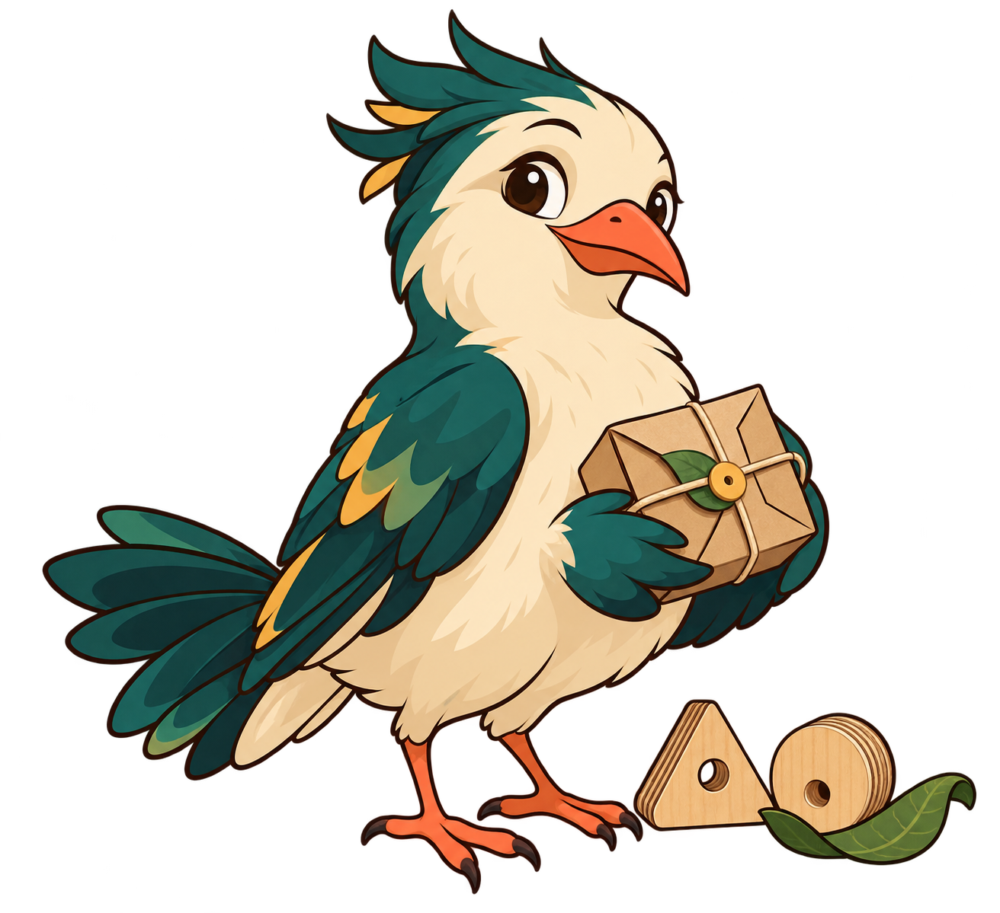

<div align="center">



# resaikel

### Turn waste into worth.

Platform circular manufacturing intelligence untuk mengubah material sisa menjadi produk yang dapat dibuat, dihitung biayanya, dan dicocokkan dengan kebutuhan pasar.

[Architecture](docs/ARCHITECTURE.md) · [AI pipeline](docs/AI_PIPELINE.md) · [Security](docs/SECURITY.md)

</div>

## Tentang resaikel

resaikel membantu pengguna memotret material sisa, mengonfirmasi kondisi fisiknya, lalu mengevaluasi produk yang mungkin dibuat darinya.

Prosesnya berjalan secara berurutan:

1. AI mendeskripsikan atribut material yang terlihat pada foto.
2. Pengguna mengonfirmasi ukuran dan fakta fisik.
3. AI memilih kandidat dari katalog produk yang telah dibatasi.
4. deterministic engine memeriksa material, ukuran, alat, proses, dan cutting layout.
5. cost engine menghitung biaya menggunakan integer minor units.
6. market dan buyer engine menyusun opportunity berdasarkan evidence yang tersedia.
7. Opportunity yang dipilih menyimpan hasil produksi, biaya, penjualan, dan material aktual tanpa mengubah estimasi awal.

Model bahasa tidak menentukan ukuran, kelayakan produksi, biaya, atau ranking. Nilai tersebut berasal dari input manusia dan deterministic domain engine.

## Reka

**Reka** adalah maskot bowerbird orisinal milik resaikel. Bowerbird dikenal sebagai burung yang mengumpulkan dan menyusun benda dengan teliti. Karakter ini mewakili cara resaikel menemukan kegunaan baru dari material yang sering diabaikan.

Reka membawa prinsip utama produk: kreatif dalam melihat kemungkinan, tetapi tetap disiplin terhadap fakta.

File maskot tersedia di [`assets/reka-bowerbird-mascot.png`](assets/reka-bowerbird-mascot.png).

## Prinsip produk

- **Measured, never guessed.** Foto tidak digunakan untuk menebak dimensi, berat, komposisi, grade, atau kekuatan struktural.
- **Catalogue-bound discovery.** AI hanya dapat memilih spesifikasi yang diberikan kepadanya.
- **Hard gates before scores.** Produk yang tidak dapat dibuat tidak akan diselamatkan oleh skor ekonomi yang tinggi.
- **Explainable money.** Semua perhitungan biaya menggunakan minor currency units dan basis yang dapat diperiksa.
- **Unknown stays unknown.** Data yang tidak tersedia tidak digantikan dengan angka buatan.
- **Consent-aware matching.** Nama bisnis hanya ditampilkan jika pemiliknya mendaftar dan memberi persetujuan untuk matching.

## Menjalankan project

### Persyaratan

- Node.js 20.11 atau lebih baru
- Java runtime untuk Firestore emulator

### Instalasi

```bash
npm install
cp .env.example .env.local
```

Jalankan layanan pada terminal terpisah:

```bash
# Terminal 1
npm run emulators

# Terminal 2
npm run seed

# Terminal 3
npm run dev -- --port 3000
```

Buka [http://localhost:3000](http://localhost:3000).

Demo account lokal:

```text
Email: demo@resaikel.test
Password: resaikel-demo
```

Gemini API key tidak diperlukan untuk local development. Jika `GEMINI_API_KEY` tidak tersedia dan `AI_MODE=auto`, aplikasi memakai offline mock adapter yang deterministic dan tidak menimbulkan biaya API.

## Fitur utama

- Authentication dengan Google atau email dan password
- Secure HTTP-only session cookie dan organization-level tenancy
- Multi-photo material upload dengan client compression dan server validation
- AI-assisted material description dengan field-level confidence
- Human confirmation gate untuk fakta fisik
- Curated product catalogue dengan bounded parameters
- Deterministic feasibility engine dan 2D guillotine nesting
- Explainable cost model dengan sebelas cost lines
- Evidence-based market assessment
- Consent-aware buyer matching dan capacity shortfall detection
- Hard-gated opportunity ranking
- Estimated-versus-actual production outcome tracking
- Responsive UI menggunakan Manrope dan maskot Reka

## Batas implementasi saat ini

- Feasibility menggunakan model rectangular 2D, bukan analisis struktural atau model 3D.
- Cutting layout menggunakan pendekatan guillotine yang konservatif.
- Posisi defect belum dipetakan sebagai koordinat pada sheet.
- Market evidence masih berupa curated sample data dan bukan hasil marketplace scraping.
- Buyer matching bekerja pada category level kecuali terdapat registered demand.
- Belum ada quotation, messaging, payment, atau transaction workflow.
- Tidak ada carbon-saving claim karena belum tersedia metodologi yang tervalidasi.

## Struktur repository

```text
src/
├── app/          Next.js pages, layouts, dan API routes
├── components/   UI primitives dan feature components
├── domain/       Pure TypeScript domain engines
├── ai/           Prompts, schemas, client, cache, dan mock adapter
├── server/       Authentication, repositories, services, dan HTTP boundaries
└── lib/          Shared configuration dan utilities

assets/           Brand dan mascot assets
docs/             Technical and product documentation
tests/            Domain, AI contract, scenario, dan real-photo tests
```

Domain layer tidak bergantung pada React, Firebase, browser, network, atau language model. Pemisahan ini membuat perhitungan inti dapat diuji secara deterministic.

## Quality checks

```bash
npm run check
npm test
npm run test:coverage
npm run build
```

Baseline saat ini: **195 tests passed dan 1 optional real-photo case skipped**.

Test suite mencakup money arithmetic, unit conversion, packing, feasibility gates, costing, market aggregation, buyer matching, ranking, AI schemas, catalogue enforcement, unsafe claims, caching, sample scenarios, dan real photograph validation.

## Dokumentasi

- [Product requirements](docs/PRODUCT_REQUIREMENTS.md)
- [Product improvement roadmap](docs/PRODUCT_IMPROVEMENT_ROADMAP.md)
- [Architecture](docs/ARCHITECTURE.md)
- [Data model](docs/DATA_MODEL.md)
- [AI pipeline](docs/AI_PIPELINE.md)
- [Feasibility engine](docs/FEASIBILITY_ENGINE.md)
- [Security](docs/SECURITY.md)
- [Deployment](docs/DEPLOYMENT.md)
- [Product audit](docs/PRODUCT_AUDIT.md)
- [Refinement plan](docs/REFINEMENT_PLAN.md)
- [Refinement report](docs/REFINEMENT_REPORT.md)

## Teknologi

Next.js 15, React 19, TypeScript strict mode, Tailwind CSS v4, Firebase Auth, Firestore, Cloud Storage, Google Gemini, Zod, dan Vitest.

Tidak ada component framework, state-management library, atau perhitungan domain yang disembunyikan di dalam model.

---

<div align="center">

**Build useful things from what already exists.**

<sub>resaikel · circular manufacturing intelligence</sub>

</div>
