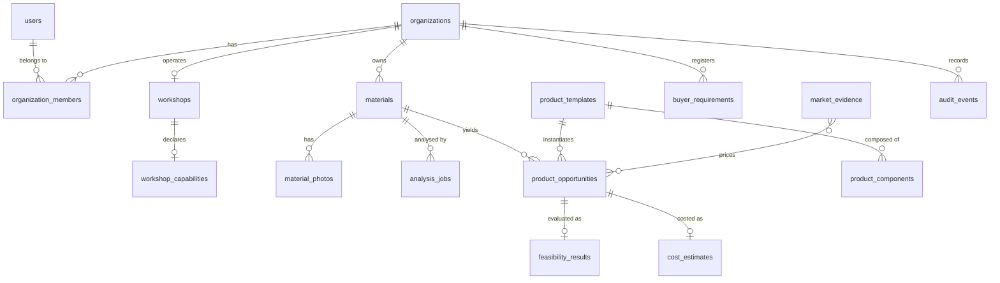

# Data model

Firestore collections. Every document carries `schemaVersion`, `createdAt` and
`updatedAt`; tenant-owned documents also carry `orgId`.

Timestamps are stored as **ISO-8601 strings** rather than Firestore Timestamps.
ISO strings sort lexicographically in the same order as instants, so
`orderBy('createdAt', 'desc')` behaves identically, and a cursor is simply the
previous page's last value. It also keeps documents readable in the emulator UI.

## Relationships



## Collections

### Identity

| Collection | Document id | Notes |
|---|---|---|
| `users` | Firebase uid | Profile mirror. `roles` is the declared user role list, `defaultOrgId` the preferred organisation |
| `organizations` | Auto id | `currency`, `country`, `locale` — the source of every monetary label |
| `organization_members` | `<orgId>_<uid>` | **The authorisation source of truth.** The composite id means the security rules resolve membership with a single document read |

The `<orgId>_<uid>` convention requires organisation ids to be alphanumeric
without underscores, which is why `src/domain/ids.ts` asserts that invariant.

### Material

| Collection | Document id | Notes |
|---|---|---|
| `materials` | Auto id | Attributes, dimensions, quantity, availability, status, and a `provenance` map keyed by attribute name |
| `material_photos` | Auto id | `storagePath`, `sha256`, size, dimensions, `order`. Objects live at `materials/{orgId}/{materialId}/{file}` |
| `analysis_jobs` | Auto id | Async analysis: `status`, `inputHash`, claim fields, validated `output`, usage, error |

`materials` denormalises `photoCount` and `primaryPhotoId` so the inventory list is
one query with no secondary read.

**Provenance** is per field, not per document:

```jsonc
{
  "category":  { "source": "ai",       "confidence": 0.62, "recordedAt": "..." },
  "lengthMm":  { "source": "measured", "recordedAt": "..." },
  "thicknessMm": { "source": "unknown", "recordedAt": "..." }
}
```

`source` is one of `ai`, `user`, `measured`, `unknown`. Confirmation requires the
critical attributes to carry `user` or `measured`; an AI inference is never
sufficient. This is what makes "a photograph cannot establish a dimension" a
structural property rather than a guideline.

### Catalogue

| Collection | Document id | Notes |
|---|---|---|
| `product_templates` | Template slug | The validated specifications. Seeded from `src/domain/catalog/templates.ts` |
| `product_components` | Derived | Parts of a template |

The catalogue is **code-first**: `src/domain/catalog/templates.ts` is the source
of truth, and the seed mirrors it into Firestore for reference reads. The
application never reads a template from Firestore, so a database edit cannot
change what the engines will build.

Templates are declarative and JSON-serialisable. Parameters are linked to part
dimensions by coefficient rules:

```ts
{ partId: 'blank', dimension: 'lengthMm', base: 30, coefficients: { length: 2, width: 2 } }
// blank length = 30 + 2 x length + 2 x width
```

### Evaluation

| Collection | Document id | Notes |
|---|---|---|
| `product_opportunities` | Auto id | Identity, template, parameters, denormalised summary numbers, ranking, embedded buyer matches, reasons and risks |
| `feasibility_results` | **`opportunityId`** | The full `FeasibilityResult`, including the one-unit nesting layout |
| `cost_estimates` | **`opportunityId`** | The full `CostEstimate`, including every assumption and line basis |

Keying the engine outputs by the opportunity id means a re-run overwrites in place
rather than accumulating near-duplicates, and reading the detail page is three
deterministic document reads with no query.

The opportunity document embeds the *summary* numbers (unit cost, reference price,
margin, max units, waste, evidence quality, best buyer score) so the comparison
screen is a single query, and embeds buyer matches because they are small, derived,
and needed in both places.

### Market and demand

| Collection | Document id | Notes |
|---|---|---|
| `market_evidence` | Seeded id | Shared reference rows. Readable by any signed-in user, writable by nobody through the client. Every row carries `sourceType` and `isSampleData` |
| `buyer_requirements` | Auto id | Registered demand. `consentToMatch` gates whether the record is ever loaded by the matching query, and `verified` mirrors it |

`sourceType` is one of `verified_transaction`, `actual_quotation`,
`public_listing`, `manual_estimate`, `hypothetical`. Each contributes a different
weight to evidence quality, so a listing price can never be presented as though it
were a completed sale.

Market assessments are **not stored**. They are recomputed from `market_evidence`
on read, so a corrected reference row takes effect immediately instead of being
frozen into an old estimate.

### Operational

| Collection | Document id | Notes |
|---|---|---|
| `audit_events` | Auto id | Append-only. A failure to record one never breaks the audited operation |
| `rate_limits` | `<orgId>_<uid>_<kind>_<window>` | Fixed-window counters, incremented in a transaction |
| `idempotency_keys` | `<orgId>_<uid>_<key>` | Request fingerprint plus the stored response, replayed on retry |

### Reserved

`rfqs`, `quotations`, `opportunity_matches` and `production_outcomes` appear in
`firestore.rules` with the correct tenant isolation, so the deferred commerce layer
needs no migration. Nothing writes to them in this release, and no UI implies
otherwise.

## Indexes

Composite indexes are declared in `firestore.indexes.json`:

| Collection | Fields |
|---|---|
| `materials` | `orgId` ASC, `status` ASC, `createdAt` DESC |
| `materials` | `orgId` ASC, `createdAt` DESC |
| `material_photos` | `orgId`, `materialId`, `order` |
| `analysis_jobs` | `materialId`, `type`, `status` |
| `analysis_jobs` | `orgId`, `type`, `inputHash`, `createdAt` DESC |
| `product_opportunities` | `orgId`, `materialId`, `createdAt` DESC |
| `product_opportunities` | `orgId`, `rank` ASC, `createdAt` DESC |
| `product_opportunities` | `orgId`, `saved`, `savedAt` DESC |
| `feasibility_results` | `orgId`, `opportunityId` |
| `cost_estimates` | `orgId`, `opportunityId`, `computedAt` DESC |
| `market_evidence` | `productCategory`, `region`, `observedAt` DESC |
| `buyer_requirements` | `kind`, `productCategories` CONTAINS, `createdAt` DESC |

Every list query in the application is backed by one of these. There is no
unbounded scan.

## Money and units

- **Money** is an integer count of minor units plus an ISO-4217 code. IDR has
  zero decimal digits and USD has two; `minorUnitDigits` is the single place that
  knows the difference. Ratios use integer numerator/denominator arithmetic with
  one half-up rounding step. Currency is never converted — the app reports what it
  cannot compare instead.
- **Dimensions** are integer millimetres. Conversion happens at the boundary from
  centimetres, metres, inches or feet.

## Referential integrity

Firestore has no foreign keys, so integrity is maintained by:

- deleting a material removes its photos, opportunities, feasibility results and
  cost estimates in one batch
- storage objects are deleted **before** their records, so a failure leaves a
  recoverable orphan record rather than an invisible, billable orphan object
- every tenant read filters on `orgId` and returns "not found" on a mismatch
