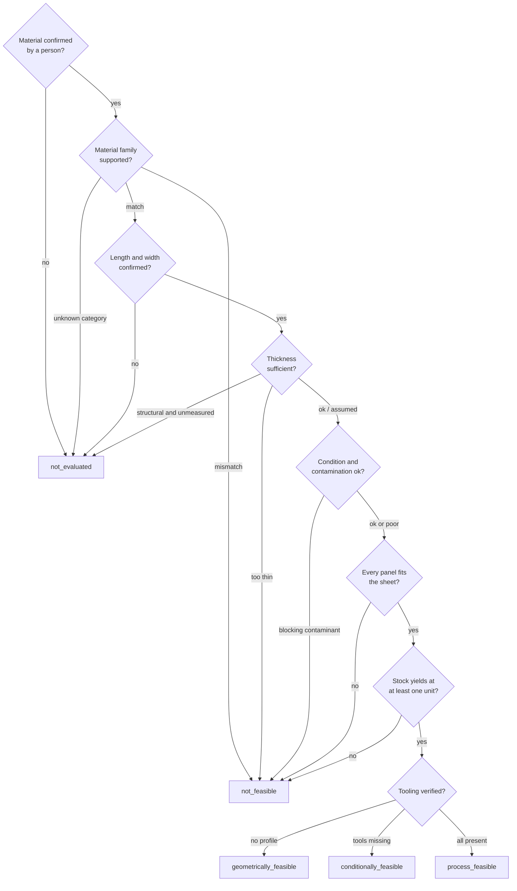
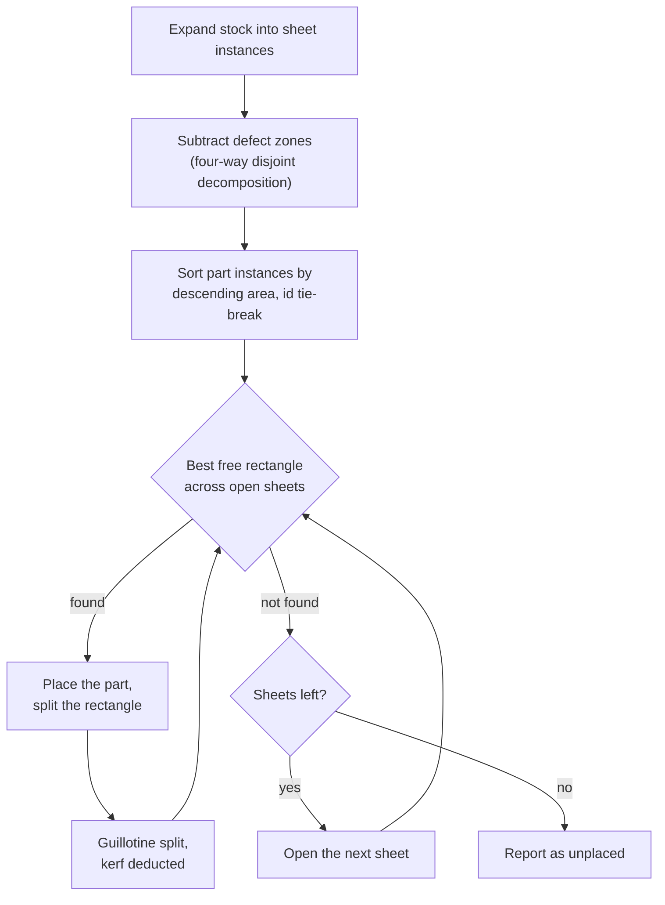

# Feasibility engine

The engine answers one question conservatively: *can this specification be cut from
this material, and how many units does it yield?* It is deliberately not a CAD/CAM
system.

## The five verdicts

| Verdict | Meaning |
|---|---|
| `process_feasible` | Nests in the stock, and every required tool is available |
| `geometrically_feasible` | The parts fit, but no workshop profile was supplied, so the process is unverified |
| `conditionally_feasible` | Nests, but tooling is missing, condition is poor, or defects were recorded but not located |
| `not_feasible` | A hard constraint failed |
| `not_evaluated` | Required properties are still unconfirmed |

The distinction matters. Collapsing them would let a geometry result masquerade as
a production green light: `geometrically_feasible` says the panels fit and nothing
more. Only `process_feasible` claims anything about the process, and even that is
an opinion rather than a certification.

## Gate order

Gates run in this order, and **every gate is evaluated and reported** even after
one has already decided the outcome, so the UI can explain all the reasons rather
than only the first.



### 1. Confirmation

Until a person confirms the properties, nothing is decided. This is the gate that
makes "an AI inference is never a measurement" real.

### 2. Material family

A plywood sheet cannot be nested into a cardboard dieline. A `unknown` category
yields `not_evaluated`, never feasible.

### 3. Dimensions

Missing length or width is `not_evaluated`, because the engine has nothing to nest
into. It is not treated as zero or as an estimate.

### 4. Thickness

The threshold is `STRUCTURAL_THICKNESS_MM = 6`:

- **≥ 6 mm** — structural. An unmeasured thickness is `not_evaluated`: measure it.
- **< 6 mm** — thin sheet goods. An unmeasured thickness is a **warning**, and the
  template's nominal thickness is recorded as an explicit assumption.

Recorded but insufficient thickness is always `not_feasible`.

### 5. Condition and contamination

Contamination is free text, so it is tokenised and matched word by word: *"Machine
oil"* trips the `oil` rule. The vocabulary covers oil, grease, chemical, toxic,
mould, mildew, asbestos, pesticide, solvent, fuel, sewage and rot.

Matching errs toward blocking. A false positive costs a user one manual
reclassification; a false negative puts hazardous material into a consumer product.
That asymmetry is intentional. Painted material is deliberately *not* on the list,
because painted plywood is a legitimate reuse case.

Poor condition is a warning, not a blocker — it reduces real-world yield below the
calculated maximum. Recorded defects cannot be excluded from the layout, because
defect *positions* are not recorded; that limitation is stated as an assumption
rather than silently ignored.

### 6. Panel fit

Every resolved part must fit some sheet in at least one orientation (rotation
permits if the part is `rotatable`). This is the gate that rejects a 730 × 250 mm
corrugated blank from a 300 × 200 mm offcut, and it names the part and both sizes
when it does.

### 7. Capacity

See the packer below. Zero units is `not_feasible`.

### 8. Tooling

Missing tools or process steps produce `conditionally_feasible` with the gap named.
A workshop that does not list the material family is flagged too. With no
capability profile at all, the result caps at `geometrically_feasible` and the UI
says so explicitly.

## The 2D cutting and packing algorithm

A deterministic guillotine packer with a best-short-side-fit rule.



### Why guillotine

A guillotine cut is what a hand tool or a panel saw actually does. Free-rectangle
packing with non-guillotine splits would report a higher yield that a real workshop
cannot achieve. The corner areas a guillotine split cannot recover are counted as
**waste**, which makes the estimate pessimistic on purpose: an offcut that nests
perfectly on a spreadsheet will not nest perfectly on a bench.

### Kerf

Kerf is deducted from the cut edge **and** the perpendicular edge on every split, so
waste is over-estimated rather than under-estimated. The default is 3 mm and it is
configurable per evaluation. The test suite includes the boundary case: two 100 mm
parts need 203 mm of width, not 202.

### Defect zones

A defect is subtracted with a four-way disjoint decomposition (left band, right
band, middle-above, middle-below). Disjointness is what guarantees two placements
can never overlap — a decomposition that allowed overlap would let the packer
double-book space.

Currently no defect coordinates reach the packer, because the confirmation UI does
not collect them. The capability exists and is tested; wiring it to the UI is
future work, and the engine states the consequence as an assumption.

### Capacity

The maximum unit count is found by binary search between 0 and an area-derived
upper bound, where the bound inflates every part by kerf:

```
upper = floor(usable stock area / Σ qty x (length + kerf) x (width + kerf))
```

Each candidate count is verified by actually packing it. Ties and ordering are
fully deterministic: area descending, then part id ascending, then sheet index,
then rectangle index. Same input, same layout, byte for byte — which is what makes
the snapshots in the test suite meaningful.

### Complexity guard

Above 400 part instances the packer returns `limitReached` with everything
unplaced, rather than grinding. The engine caps units before it ever gets there.

## What the engine does *not* do

- No 3D geometry, no structural analysis, no load rating
- No grain direction, and no flute direction for corrugated board
- No edge banding, no joinery, no curved or non-rectangular nesting
- No machine nesting file output
- No certification of any kind

Every result carries this disclaimer verbatim:

> This is a conservative 2D rectangular estimate, not a production drawing or a
> safety certification. Successful nesting does not prove structural safety, load
> capacity, regulatory compliance or commercial production readiness.

## Cardboard packaging checklist

Packaging templates carry a checklist (dimensions, material condition, strength,
product protection, print or finish, buyer specification). Every item is returned
with `satisfied: null` — meaning **unverified** — and stays that way until a person
signs it off. resaikel never asserts packaging compliance, and the UI says so
underneath the list.

## Testing

`tests/domain/packing.test.ts` and `tests/domain/feasibility.test.ts` cover:

- kerf respected, including the 202 vs 203 mm boundary
- rotation honoured, and refused for non-rotatable parts
- defect zones excluded from the usable area
- placements provably disjoint, and provably inside their sheet
- stock quantity caps respected
- determinism across runs
- family mismatch, unknown category, unmeasured structural thickness, thin board,
  contamination, poor condition, exhausted quantity
- **an undersized cardboard blank rejected with the part named**
- additional materials scaled to the batch
- every packaging checklist item left unverified
