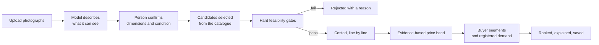

# Product requirements

## Vision

Help individuals, workshops and small businesses find commercially viable
opportunities in the material they already have — and be honest about the edge of
what can be established from a photograph and a spreadsheet.

## Personas

One application, three role-based capability sets. A single account may hold
several roles.

| Role | Wants | Gets in this release |
|---|---|---|
| Material owner | To know what the offcuts are worth | Upload, identification, confirmation, inventory, discovery, saved opportunities |
| Manufacturer | To know what they can produce | Workshop capability profile, tooling-verified feasibility, cost estimates with their own assumptions |
| Buyer | To source reclaimed material products | Registered requirements with consent, matched against discovered opportunities |

## Principles

1. **Report only what can be substantiated.** Unknown stays unknown, visibly.
2. **A person confirms physical facts.** An AI inference is never a measurement.
3. **Deterministic code produces the numbers.** A model may not compute a figure
   that reaches the database.
4. **Rejections are outputs.** A rejected candidate with a stated reason is more
   useful than a plausible one.
5. **No invented market, buyer or certification data.** Ever.
6. **One product, role-based.** Not three applications.

## Scope of this release

### Delivered

- Authentication (Google, email/password, verification, reset, session cookies)
- Onboarding (roles, organisation, country, currency)
- Material upload with client compression and server-side byte validation
- Material identification, per-field provenance, human confirmation gate
- Material inventory with status, dimensions, availability
- Product discovery from a curated parametric catalogue
- Manufacturing feasibility with ordered gates and 2D nesting
- Production cost intelligence with editable, explainable assumptions
- Market intelligence with labelled evidence, quality and freshness
- Buyer intelligence with segment matching and consent gating
- Transparent ranking with configurable weights and per-dimension explanations
- Opportunity comparison and a full detail view with a cutting diagram
- Workspace: workshop capabilities, registered demand, saved opportunities
- Sample market reference data and a seeded demo with real photographs
- A landing page whose every figure comes from the real engines

### Deferred, with the schema already in place

| Module | State |
|---|---|
| Request for quotation and quotations | Collections and rules defined; no UI, no service |
| Project messaging | Not started |
| Payment processing | Explicit non-goal; no transaction is implied anywhere |
| Production outcome tracking | Collections and rules defined; UI not started |
| Sustainability metrics | Not started, and no carbon figure is claimed |
| Reverse discovery (buyer → material → manufacturer → RFQ) | Not started |
| Full buyer and manufacturer marketplace | Not started |
| Playwright end-to-end suite | Not started |

The deferred modules are omitted from the navigation rather than stubbed. There are
no placeholder buttons and no dead links.

## Primary journeys

### Journey 1 — Waste to business opportunity

### Journey 2 — Buyer to material

Delivered up to the point where registered demand surfaces inside a manufacturer's
discovery results, with the shortfall against capacity stated when the order is
larger than the material can satisfy. The remaining steps (RFQ, quotation,
acceptance) are deferred.

### Journey 3 — Manufacturer opportunity

Delivered: capability profile, tooling-verified feasibility, per-unit and per-batch
cost with the manufacturer's own assumptions, revenue scenarios and break-even.
Quotation creation is deferred.

## Definition of done — status

| Criterion | Status |
|---|---|
| Register and sign in | Done |
| Upload a real material photograph | Done, verified with real photographs in the test suite |
| Gemini analyses the photograph | Done; runs live with a key, deterministic mock without |
| Correct and confirm attributes | Done |
| Recommend relevant product candidates | Done |
| Evaluate candidates with deterministic rules | Done |
| Reject infeasible candidates with explanations | Done |
| Calculate production costs transparently | Done, eleven lines each with its basis |
| Market estimates show sources and uncertainty | Done, with an explicit insufficient-data state |
| Suggest buyer segments without inventing active buyers | Done |
| Save opportunities | Done |
| Create and manage an RFQ | **Deferred** |
| Manufacturer can respond to an RFQ | **Deferred** |
| Record production outcomes | **Deferred** |
| Organisation data is protected | Done; see `docs/SECURITY.md` |
| Works on desktop and mobile | Done; bottom navigation on mobile, comparison optimised for desktop |
| Automated tests cover critical calculations and boundaries | Done; 187 tests |
| Deployable on Google infrastructure | Documented in `docs/DEPLOYMENT.md` |

## Ranking dimensions

| Dimension | Default weight | Scoring |
|---|---|---|
| Manufacturing feasibility | 0.22 | 1.0 process feasible · 0.7 geometrically · 0.45 conditionally |
| Estimated economic value | 0.30 | Contribution per unit, normalised against the best candidate in the set |
| Material utilisation | 0.18 | Product area as a share of the stock area consumed |
| Buyer compatibility | 0.15 | Best match score across the shown factors |
| Market evidence quality | 0.10 | Strong 1.0 · moderate 0.66 · weak 0.33 · insufficient **unknown** |
| Production simplicity | 0.05 | Low 1.0 · medium 0.6 · high 0.3 |

Weights are relative and configurable. Unknown dimensions are excluded from the
weighted average and reported separately — an unknown is not a zero, and a
candidate with no market evidence must not be silently punished as though its
evidence were bad.

## Success measures

Deliberately observable rather than aspirational:

- A user can go from photographs to a saved opportunity without leaving the flow
- Every monetary figure on screen can be traced to a named, editable assumption
- No candidate is ever presented as production-ready without a validated
  specification
- No screen shows a price, a buyer or a certification the system cannot
  substantiate
- The engines produce identical output for identical input, verified by tests
