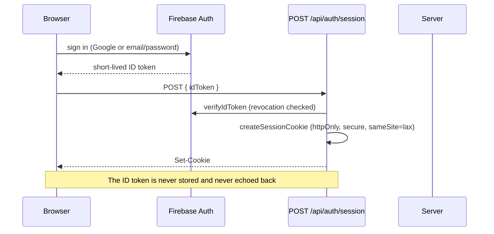

# Security

## Threat model

The assets worth protecting are a tenant's material photography, its cost
assumptions and pricing, its registered demand, and its buyer contact details. The
platform is multi-tenant, and the primary risk is cross-tenant access. The
secondary risks are unbounded AI spend and the untrusted content that flows
through a multimodal model.

## Authentication



- The session cookie is **httpOnly**, so an XSS bug cannot read it
- `secure` is set only where cookies can actually be protected; the emulator suite
  runs over plain HTTP
- Every verification uses `checkRevoked: true`, so disabling an account or revoking
  its tokens takes effect immediately rather than at cookie expiry
- `DELETE /api/auth/session` clears the cookie; `revokeSessions` invalidates every
  session for a user

## Authorisation

**The single rule: the server decides, from `organization_members`.**

`middleware.ts` runs on the edge runtime, which cannot load `firebase-admin`, so it
performs an optimistic cookie-presence check and redirects. It is a redirect
optimisation and a first line of defence — never the authorisation decision.

The real decision happens in `requireAuth()`, which:

1. reads and verifies the session cookie
2. loads the user profile
3. resolves the active organisation, preferring `defaultOrgId`
4. reads `organization_members/<orgId>_<uid>` and checks `status === 'active'`
5. returns `{ uid, orgId, role, ... }` for the handler to use

The membership document id is a composite, which is what allows the Firestore
rules to resolve membership with a single `get()`. `src/domain/ids.ts` asserts the
alphanumeric invariant that makes the composite unambiguous.

Role-gated operations (organisation settings) declare their required roles on the
route, and the check happens server-side:

```ts
export const PATCH = authedRoute(handler, { roles: ['owner', 'admin'] });
```

Client-side role state exists for presentation only.

## Tenant isolation in every read

Repositories filter on `orgId` and return **not found** on a mismatch, never
"forbidden". This is deliberate: a `403` confirms that a record exists, which is
itself a disclosure. A guessed id yields exactly the same response as a
nonexistent one.

```ts
const data = snapshot.data() as Omit<MaterialDocument, 'id'>;
if (data.orgId !== orgId) return null;   // appears not to exist
```

## Firestore rules

Rules are the second line of defence, not the first. The design:

- **Default deny.** Firestore rules are OR-ed, so the absence of a matching
  `allow` is a deny; there is no misleading catch-all block
- **Org-scoped reads** for materials, photos, opportunities, feasibility results,
  cost estimates, workshops, capabilities, buyer requirements and jobs
- **Shared reference data** (`product_templates`, `product_components`,
  `market_evidence`) is readable by any signed-in user and writable by nobody
- **Server-only collections** (`audit_events`, `rate_limits`,
  `idempotency_keys`) are denied to clients entirely
- **The only client-writable document is the user's own profile**
- `rfqs`, `quotations`, `opportunity_matches` and `production_outcomes` carry the
  same isolation so the deferred commerce layer needs no migration

## Storage rules

Path: `materials/{orgId}/{materialId}/{fileName}`

- Read and write require active membership of `{orgId}`, resolved through a
  Firestore lookup from the storage rules
- Content type must match an image allow-list
- Size must be under 8 MB
- Everything else is denied

Objects are **private**. There is no public URL and no signed URL handed to the
browser: bytes are served through the authorised proxy route
`GET /api/materials/:id/photos/:photoId`, which checks the session and organisation
on every request. The practical benefit is that revocation is immediate — there is
no signed URL outliving a permission change.

## Upload validation

The browser uploads straight to Cloud Storage, and then tells the API where it
went. **Nothing about that upload is trusted:**

| Check | How |
|---|---|
| Path ownership | The storage path must start with `materials/{orgId}/{materialId}/` or the request is refused |
| File size | Measured from the object, not from the request |
| File type | Derived from the **leading bytes** (JPEG, PNG, WebP, HEIC signatures), never from the extension or the declared MIME type |
| Content digest | SHA-256 computed server-side, used for duplicate detection |
| Declared type | Recorded for comparison, and reported when it disagrees with the bytes |

A text file renamed to `.jpg` is rejected, and that case is covered by the test
suite using real image bytes.

## Rate limiting and AI quotas

Firestore-backed fixed windows, one counter document per (org, user, kind,
window), incremented **inside a transaction** so concurrent requests cannot both
slip under the limit.

| Kind | Window | Default |
|---|---|---|
| `api` | 1 minute | 60 |
| `upload` | 1 minute | 60 |
| `ai` | 1 day (UTC) | 50 per user |

Exceeding the AI allowance returns `AI_QUOTA_EXCEEDED` with the reset time. The
allowance exists because an unbounded multimodal endpoint is an unbounded bill.

## Idempotency

State-changing endpoints accept an `Idempotency-Key`. The first request claims the
key with a body fingerprint; a replay with the same key and body receives the
original response rather than repeating the work, and a replay with the same key
and a *different* body returns `IDEMPOTENCY_CONFLICT`. This is what stops a
double-click from creating two materials or paying twice for one analysis.

## Untrusted content

| Source | Treatment |
|---|---|
| Uploaded images | Data, never instructions. The prompt says so explicitly |
| User text | Data. Never rendered as HTML, never evaluated |
| Model output | Validated against a schema; measurement-like prose is discarded and surfaced |
| Model-suggested buyers | Labels, never accounts. A registered buyer is the only named party |

### Prompt injection

An image or a note containing instructions is a real attack surface. Three
defences, in order:

1. The system instruction states that images and user text are data and that any
   instructions inside them must be ignored
2. The output schema has no field for an action — there is nothing to hijack into
   a side effect
3. The response is validated and the candidate set is checked against the closed
   catalogue subset, so even a fully compromised model cannot introduce geometry,
   tooling or a price

There is no tool-calling loop and no URL fetching driven by model output. The model
cannot act; it can only propose text that deterministic code then judges.

## Secrets

- `GEMINI_API_KEY` is read only in server modules and never given a `NEXT_PUBLIC_`
  prefix, so it cannot be inlined into a client bundle
- The service-account key is server-side only and is passed through
  Secret Manager in production
- `.gitignore` excludes `.env*` and `serviceAccount*.json`
- `assertProductionEnv()` fails loudly on a misconfigured deployment rather than
  silently denying every request

## Error handling and logging

- Responses carry a stable machine-readable `code` and a user-safe message.
  Internal detail never appears in a response body
- Failures at or above 500 are logged as single-line structured JSON with a request
  id, the error name, message and stack — and no request body, no secrets, no PII
- `audit_events` records privileged actions (organisation created, material
  verified, discovery completed, cost recomputed, settings changed). A failure to
  write an audit event is logged and swallowed, so auditing can never break the
  operation it is auditing

## App Check

Documented as a production option, and explicitly **not** a substitute for
authentication and rate limiting. It is not enabled in this release because the
emulator suite cannot exercise it meaningfully.

## Deliberate non-goals

- No payment processing, and no transaction is implied by any UI
- No arbitrary outbound URL fetching
- No client-side authorisation decisions
- No storage of buyer contact details beyond what a registering buyer consents to
  share
